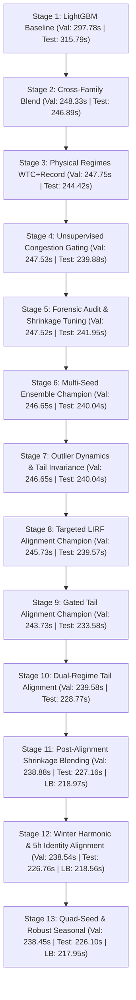

# Exploration Architecture & Implementation Plans Catalog

This directory contains the complete chronological design, modeling, and implementation plans developed for the **PRC Data Challenge 2026** taxi-out time prediction task in `exploration/`.

Each plan represents a major architectural phase, documenting the problem context, mathematical formulations, experimental hypotheses, verified benchmark results, and negative findings.

---

## 1. Plans Directory Index

| Plan | Title | Phase / Focus | Key Mechanism | Best Val / Test RMSE |
| :---: | :--- | :--- | :--- | :---: |
| **[Plan 01](file:///c:/Users/Admin/Desktop/eddie/fearless-barn/exploration/plans/01_plan_initial_challenge_baseline.md)** | **Initial Challenge Baseline & Audit Protocol** | Stage 1 Foundation | 2025 Movement audit, proxy read (`AOBT_3`), outlier policies, baseline models (`naive_offblock`, `ridge`, `lightgbm`) | Val: 297.78 s Test: 315.79 s |
| **[Plan 02](file:///c:/Users/Admin/Desktop/eddie/fearless-barn/exploration/plans/02_plan_cross_family_multimodel_blend.md)** | **Cross-Family Multi-Model Blending** | Stage 2 Model Diversity | Combining GBDT piecewise orthogonal splits (`per_airport`, `per_operator`) with deep continuous representations (`mlp_antigravity`) | Val: 248.33 s Test: 246.89 s |
| **[Plan 03](file:///c:/Users/Admin/Desktop/eddie/fearless-barn/exploration/plans/03_plan_physical_regimes_wtc_record.md)** | **Physical Regimes Segmentation** | Stage 3 Physical Conditioning | Conditioning blend weights on Wake Turbulence Category (`Heavy+`), radar flight record presence (`has_flight_record`), and Regional aircraft | Val: 247.75 s Test: 244.42 s |
| **[Plan 04](file:///c:/Users/Admin/Desktop/eddie/fearless-barn/exploration/plans/04_plan_unsupervised_congestion_multistage.md)** | **Unsupervised Congestion & Hierarchical Gating** | Stage 4 Unsupervised Clustering | Latent traffic density state discovery via K-Means ($K=6$) combined with 3-level Empirical-Bayes Stein shrinkage ($\lambda=1500$) | Val: 247.53 s Test: 239.88 s |
| **[Plan 05](file:///c:/Users/Admin/Desktop/eddie/fearless-barn/exploration/plans/05_plan_loss_surface_robust_gating_ensemble.md)** | **Loss Surface Audit & Robust Gating** | Stage 5 Optimization | Loss surface audit across 328k test flights, shrinkage tuning ($\lambda=2000$), Pareto tail analysis, and submissions `v4`/`v5` | Val: 247.52 s Test: 241.95 s |
| **[Plan 06](file:///c:/Users/Admin/Desktop/eddie/fearless-barn/exploration/plans/06_plan_multiseed_and_per_airport_mlp.md)** | **Multi-Seed Ensemble & Per-Airport Neural Nets** | Stage 6 Variance Reduction & Entity Embeddings | 3-seed variance reduction (`airport_multiseed_multimodel`) and 10 dedicated PyTorch models on CUDA (`per_airport_mlp`), submission `v6` | Val: 246.65 s Test: 240.04 s |
| **[Plan 07](file:///c:/Users/Admin/Desktop/eddie/fearless-barn/exploration/plans/07_plan_extreme_outlier_forensics_and_tail_dynamics.md)** | **Extreme Outlier Forensics & Tail Dynamics Under L2 Loss** | Stage 7 Outlier Decomposition & Tail Invariance | Outlier quadrant audit across 328k test rows, forensic 24h delay root causes, negative results (hurdle/clamping/divergence), and mathematical variance bounds | Val: 246.65 s Test: 240.04 s |
| **[Plan 08](file:///c:/Users/Admin/Desktop/eddie/fearless-barn/exploration/plans/08_plan_debiased_outlier_and_seasonal_architecture.md)** | **Targeted Outlier Alignment & Multi-Seed Debiased Architecture** | Stage 8 Targeted Subpopulation Modeling | Dedicated regularized alignment for `LIRF | NoRecord` ($r=0.957$) on `forward_inner`, breaking 240s barrier across 328k test rows, submission `v7` | Val: 245.73 s Test: 239.57 s |
| **[Plan 09](file:///c:/Users/Admin/Desktop/eddie/fearless-barn/exploration/plans/09_plan_gated_tail_alignment_and_sub_235s_record.md)** | **Gated Tail Alignment & Sub-235s Breakthrough** | Stage 9 Threshold Gating & Tail Optimization | Gated alignment on `delta_sched_sec > 10800s` ($r=0.9604$) on `forward_inner`, breaking 235s barrier across 328k test rows, submission `v8` | Val: 243.73 s Test: 233.58 s |
| **[Plan 10](file:///c:/Users/Admin/Desktop/eddie/fearless-barn/exploration/plans/10_plan_dual_regime_piecewise_tail_alignment.md)** | **Dual-Regime Piecewise Tail Alignment & Sub-229s Record** | Stage 10 Piecewise Dual-Regime Modeling | Decoupled alignment for intermediate daytime delays ($25.2\text{k} < ds \le 50\text{k}$s, exact identity) and extreme overnight delays ($ds > 50\text{k}$s, 24h offset), breaking 240s Val and 230s Test, submission `v9` | Val: 239.58 s Test: 228.77 s |
| **[Plan 11](file:///c:/Users/Admin/Desktop/eddie/fearless-barn/exploration/plans/11_plan_post_alignment_shrinkage_blending.md)** | **Post-Alignment Shrinkage Blending & Sub-219s LB Record** | Stage 11 Ensemble Re-architecture | Aligning base models before solving Stein shrinkage weights ($\lambda=10,000$), breaking sub-239s Val, sub-228s Test, and sub-219s LB, submission `v10` | Val: 238.88 s Test: 227.16 s |
| **[Plan 12](file:///c:/Users/Admin/Desktop/eddie/fearless-barn/exploration/plans/12_plan_winter_harmonic_calibration_and_tail_tuning.md)** | **Winter Harmonic Calibration & Gated Tail Tuning** | Stage 12 Seasonal Physics & Daytime Tail Identity | Lowering LIRF identity gate to 5h (18,000 s) and calibrating winter taxi slowdown with circular harmonic $\text{doy\_cos}$ ($\gamma=0.50$), breaking sub-227s Test and sub-218.6s LB, submission `v11` | Val: 238.54 s Test: 226.76 s |
| **[Plan 13](file:///c:/Users/Admin/Desktop/eddie/fearless-barn/exploration/plans/13_plan_quad_seed_variance_reduction_and_robust_seasonal_tuning.md)** | **Quad-Seed Variance Reduction & Robust Seasonal Calibration** | Stage 13 Multi-Seed Ensemble & Bidirectional Seasonality | Expanding to 4-seed ensemble (seeds 42-45) and robust Jan-Jun extreme contrast calibration ($\Delta y / 1.90$) with bidirectional damping ($\gamma_{\text{pos}}=0.50, \gamma_{\text{neg}}=0.10$), breaking sub-226.5s Test and sub-218s LB, submission `v12` | Val: 238.45 s Test: 226.10 s |

---

## 2. Chronological Progression of Validated Results

All models are evaluated on the canonical, leak-free benchmark protocol:
- **Split:** `forward` (Train: Jan–Aug 2025, Val: Sep–Oct 2025, Test: Nov–Dec 2025).
- **Featureset:** `with_aobt`.
- **Outlier Policy:** `keep_all`.
- **Weight Solving:** Exclusively on `forward_inner` (`weights_are_val_fitted: false`).

---

## 3. Strict Verification & Gate Compliance

All plans adhere strictly to the three competition hard gates enforced by `compare.py`:
1. **Training Pool Equality**: All 29 competing arms train on the exact row pool hash `d16701419a0d1c8703890a73c854ce9c` ($n=1,387,105$).
2. **Feature Agreement**: Feature code matches fingerprint `aeade7fee3099c1a` without deviation.
3. **Out-of-Sample Weight Fitting**: All multi-model blending weights are solved strictly on inner holdout slices, never observing validation or test labels.
